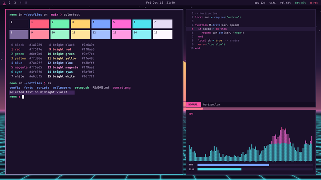
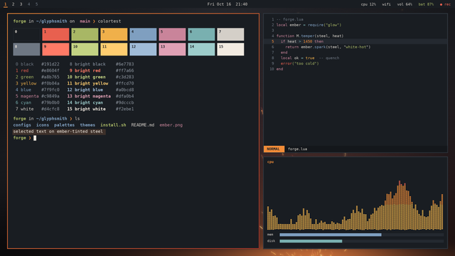

# Glyphsmith themes

**Carefully tuned desktop themes for [Omarchy](https://omarchy.org) 4 (Hyprland), by synthalorian.**

Every theme here gets a full palette, matching wallpapers, btop colors and an icon pick, and is tested with a real Omarchy install before it ships. Each one lives in its own repo and installs with Omarchy's own `omarchy-theme-install`, so nothing extra is needed. New themes land often, and this page always lists every one, newest first.

Try one in a single line, or grab the picker below to browse them all.

## Pick one from the terminal

```bash
git clone https://github.com/synthalorian/glyphsmith-themes
./glyphsmith-themes/glyphsmith            # menu (fzf or walker if installed, a numbered list otherwise)
./glyphsmith-themes/glyphsmith list       # list the themes
./glyphsmith-themes/glyphsmith install neon-horizon
```

## Gallery

<!-- gallery:start -->

### [Neon Horizon](https://github.com/synthalorian/omarchy-neon-horizon-theme)

[](https://github.com/synthalorian/omarchy-neon-horizon-theme)

Synthwave after dark: a deep midnight purple base under a hot pink sun, with neon cyan grid lines and magenta glow.

`dark` · accent `#ff4fa3` · v0.1.0, released 2026-10-17 · [repo](https://github.com/synthalorian/omarchy-neon-horizon-theme) · [release](https://github.com/synthalorian/omarchy-neon-horizon-theme/releases/tag/v0.1.0)

```bash
omarchy-theme-install https://github.com/synthalorian/omarchy-neon-horizon-theme
```

### [Steel & Ember](https://github.com/synthalorian/omarchy-steel-and-ember-theme)

[](https://github.com/synthalorian/omarchy-steel-and-ember-theme)

Dark and warm, like forged steel and glowing ember: a blue-grey charcoal base with ember orange, amber and forge-red accents.

`dark` · accent `#f28c38` · v0.1.0, released 2026-10-17 · [repo](https://github.com/synthalorian/omarchy-steel-and-ember-theme) · [release](https://github.com/synthalorian/omarchy-steel-and-ember-theme/releases/tag/v0.1.0)

```bash
omarchy-theme-install https://github.com/synthalorian/omarchy-steel-and-ember-theme
```

<!-- gallery:end -->

## Adding a theme

See [CONTRIBUTING.md](CONTRIBUTING.md).

## License

MIT © 2026 synthalorian. Each theme carries its own license in its repo.
